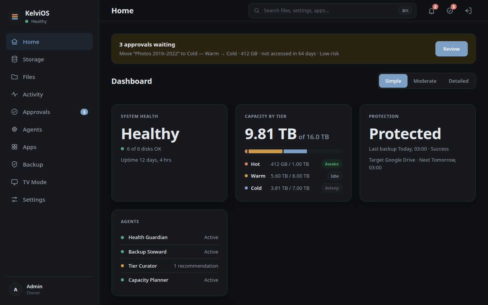
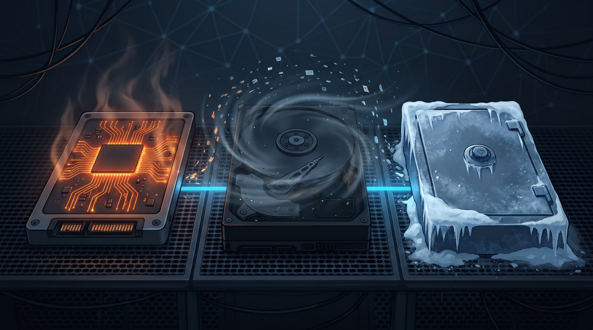

# KelviOS

**An agent-native personal NAS OS that keeps every byte at the right temperature.**

KelviOS pools drives of different sizes and adds the one idea mainstream NAS systems are missing: **Hot–Warm–Cold storage tiering driven by how often your data is actually accessed**. Hot data stays instantly available. Cold data sleeps on cheap drives that are *powered off completely* — no spinning, no wear, no wasted electricity — and wake only when there is real work.

On top of that, KelviOS is **agent-native**: it is API-first, ships an MCP server, and can be managed end-to-end by agents over a built-in harness — while destructive actions always stay behind a human approval gate. The core is a **single static Go binary** with an embedded web UI and an embedded SQLite database, designed to idle at ≤ 200 MB of RAM.

> **Status: alpha.** KelviOS is under active development and is not yet beta or production-ready. See [Status](#status) for exactly what is done and what is not.

## Highlights

- **Tiering that runs itself.** A built-in Tier Curator watches access heat, recommends moves between tiers, and can migrate aging data to Cold under a configurable silent-consent policy. Frequently accessed Cold files are cached as a *shadow* on Warm under the same logical path, so reads stay fast without waking a disk.
- **Agent-native by design.** Full management over REST API (OpenAPI) and MCP. An LLM-agnostic harness with starter agents for drive health, backup stewardship, tiering, and capacity planning. Agents hold scoped credentials; destructive actions require explicit human approval.
- **Manage it from chat.** The Chat Bridge (WhatsApp and Telegram) delivers scheduled health and backup reports, lockout notifications, and approval requests to your messenger.
- **Signed OTA with A/B rollback.** Updates are cryptographically signed (FR-5.1) and install to the inactive OS partition (FR-5.8); a failed boot or health check falls back to the previous partition automatically. Update packages can also be applied offline from USB.
- **A first-boot wizard anyone can use.** Fully generic — no personal names, domains, or infrastructure baked in — with language choice (Indonesian + English), time zone, admin account creation, and optional configuration import (FR-5.2).
- **Backups that leave the house.** Deduplicated, encrypted backups via Restic to multiple remote providers, with restore verification built in.
- **An app catalog, not bloat.** Home-server apps live in the App Library as metadata only — zero RAM, zero open ports — until you install them. A Compose driver and app update management with rollback are built in.
- **One screen for everything that runs.** The Activity & Automation screen shows core schedules, automation rules, agent tasks, and backup history with status and controls, on web and mobile surfaces.
- **No vendor lock-in.** Your data lives on standard filesystems, readable by any Linux machine without KelviOS installed. No proprietary formats, no required cloud account, telemetry is opt-in and off by default.



## Architecture

- **Core:** one static Go binary (`kelvios-core`, CGO disabled). No PHP, no Python, no separate database server, no external runtime.
- **Storage of state:** embedded SQLite (pure-Go driver) — configuration, catalog, rules, and audit log in one file.
- **Frontend:** a React + TypeScript web app, embedded into the binary at build time. Dark theme by default.
- **API-first:** the web UI, the Chat Bridge, and agents are equal clients of the same API. The MCP server exposes management tools to any MCP-compatible agent or harness.
- **System image:** a minimal Debian image built by `image/build-image.sh`, with a dual-partition A/B layout (EFI + root-A + root-B + data) and GRUB fallback to the previous slot.
- **Drivers, not hardcoding:** storage mechanisms (single disk, Btrfs RAID0/RAID1, MergerFS + SnapRAID, optional ZFS installed on-device) sit behind a driver registry, so the core stays storage-agnostic.

See `docs/LICENSE.md` for the full component and license inventory.

## Build from source

Prerequisites: Go 1.27.3 and Node.js (for the web UI).

```bash
# 1. Build the web UI
cd webapp
npm install
npm run build
cd ..

# 2. Sync the built UI into web/dist for embedding
bash scripts/sync-webui.sh        # or: make webui

# 3. Build the core binary
CGO_ENABLED=0 go build -o bin/kelvios-core ./cmd/kelvios-core   # or: make build

# 4. Run it, then open the first-boot wizard in your browser
./bin/kelvios-core
```

Run the test suite with `go test ./...` (or `make check` for vet + tests). Building the bootable system image is documented in `image/README.md`.

## Status

KelviOS is **alpha** software. It is built and used by its author first; it has not yet passed the gates for a community beta.

**Done**

- Phase 2 (storage, catalog, backup): 100% of planned requirements.
- Phase 3 (agents, harness, MCP/API, Chat Bridge, automation rules): 100%.
- Phase 1 (platform fundamentals): 14 of 17 requirements, including per-pool planning, the file manager, and Chat Bridge lockout notifications.
- Signed OTA updates with automatic rollback (FR-5.1), the generic first-boot wizard (FR-5.2), the A/B dual-partition image with boot-proven fallback (FR-5.8), and a completed license-hygiene audit (FR-5.5).
- The web UI now defaults to a dark theme across the wizard and the dashboard.

**Not done yet — read before relying on KelviOS**

- **Hardware gate open:** the 24-hour idle-stability measurement on the reference hardware profile (PRD A0.1) has not been completed, and no physical board has been qualified yet (the QVL, FR-5.3, is unpublished). Power behaviour of physical disks, thermals, and BIOS power recovery cannot be proven in a VM.
- **Phase 5 remainder:** the Extension SDK & builder sandbox (FR-5.6), platform security-update channel (FR-5.7), and agent self-maintenance layers 2–3 (FR-5.9) are not built. The community-beta packaging requirement (FR-5.4) is in preparation.
- **Parked on purpose:** the CCTV pattern (FR-4.3) and the TV Shell cluster (FR-4.5/4.6/4.9–4.12) are scheduled last, when real TV hardware is available to judge the renderer.
- **Remaining Phase 1 items:** LUKS pool encryption, the Btrfs mechanism path, and disk power actuation are partial or pending.
- **No project license yet** (see below), no public issue tracker process, and no support commitment of any kind: expect breaking changes between commits.

## Roadmap

Where KelviOS is heading next. These are design-committed directions, not release promises — ordering follows the project's gates, not a calendar.

- **A real desktop, in your browser.** A windowed desktop environment — icons and Trash on the desktop, a dock, a Start menu, snapping windows, dialogs as windows — that wraps the existing KelviOS surfaces instead of replacing them. Desktop state is stored per user on the box and follows you between devices. *(In development.)*
- **One shell, every screen.** The same desktop adapts its presentation automatically: pointer type, touch, and screen size decide whether you get the full desktop, a full-screen card stack on phones, or a 10-foot launcher on TV — with a manual Auto / TV / Desktop / Mobile switch remembered per device. There is no separate TV or mobile product. *(In development; the TV presentation lands with the TV hardware gate.)*
- **HDMI mode.** Plug the box into a monitor or TV and it presents its own desktop full-screen — the same applications, data, and permissions, rendered locally with no network hop, and fully functional while the internet is down. The local session starts from a limited profile; a PIN elevates it. *(Planned.)*
- **A TV home that leads with media.** In TV presentation, the home screen is a 10-foot launcher — Media, Photos, the CCTV wall, and one tile into the full desktop. *(Planned, together with the CCTV pattern.)*
- **Mobile as companion first.** On phones, the default home is a console: agent approvals front and center, storage health, notifications, photo-backup status, and quick actions that complete on the spot. The full OS experience stays one tap away. *(Planned.)*
- **Your phone is the TV remote.** A remote app you open and close like any other app — focus-based touchpad navigation, media transport controls, the phone as a keyboard, and push-to-talk voice commands to the agent, scoped to safe actions only. *(Planned.)*
- **Every screen at once.** One account can be signed in on the TV, a laptop, and a phone simultaneously. Accounts belong to people, not devices; each person keeps their own desktop, permissions, and quotas. *(In development, with the desktop.)*
- **First-class macOS integration.** The box appears in Finder automatically (Bonjour discovery), serves as a Time Machine target with Mac-tuned SMB — no `._` litter, Finder metadata intact — and pairs with iPhone photo backup. Built for the freelancer and small-studio segment, most of whom live on Macs. *(Planned.)*

## License

**To be decided.** KelviOS's own license has not been chosen yet; until a `LICENSE` file appears in this repository, the project code is all rights reserved.

The third-party components are fully inventoried in [`docs/LICENSE.md`](docs/LICENSE.md), including the GPL components distributed as-is with their source offer. One component linked into the binary, `go.mau.fi/libsignal`, is GPL-3.0 — this fact is part of the pending license decision and is documented in the audit.
